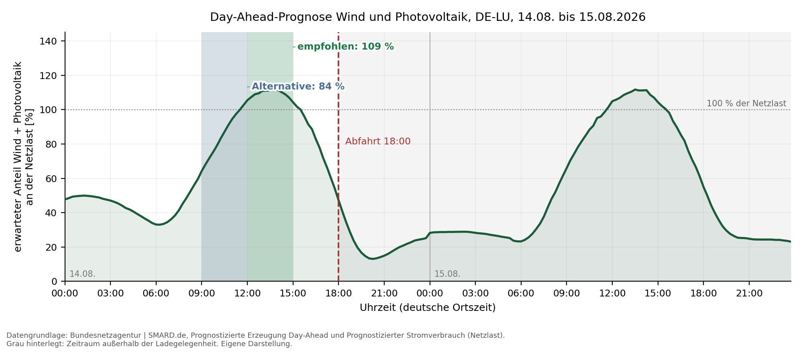

# Ladezeit-Empfehlung auf Basis öffentlicher Stromerzeugungsdaten

[](https://github.com/fabianegi/ladezeit-empfehlung/actions/workflows/tests.yml)

Proof of Concept aus einer Projektarbeit im Studiengang Data Science und Künstliche Intelligenz an
der DHBW Lörrach (2026). Die Leitfrage: Lässt sich aus frei verfügbaren Prognosedaten eine
verständliche Empfehlung ableiten, wann ein Elektroauto vor der nächsten Fahrt geladen werden
sollte, damit möglichst viel Wind- und Solarstrom im Netz ist?

Eingaben sind die geplante Abfahrtszeit und die benötigte Ladedauer. Das Programm bewertet jedes
mögliche Ladefenster zwischen frühestem Ladebeginn und Abfahrt anhand der Day-Ahead-Prognosen der
Bundesnetzagentur (SMARD). Es gibt das empfohlene Fenster, ein überschneidungsfreies alternatives
Fenster, eine kurze Begründung und eine einfache Darstellung des erwarteten Verlaufs aus. Das
Programm empfiehlt nur: Fahrzeug oder Wallbox werden nicht gesteuert, und es gibt keine Aussagen
zu Strompreisen oder CO2-Einsparungen.



Beispiel mit Abfahrt um 18:00 Uhr und 3 Stunden Ladedauer: empfohlen 12:00 bis 15:00 Uhr,
Alternative 09:00 bis 12:00 Uhr. Grau hinterlegt ist der Zeitraum außerhalb der Ladegelegenheit.

## Installation

```bash
git clone https://github.com/fabianegi/ladezeit-empfehlung.git
cd ladezeit-empfehlung

python3 -m venv .venv
source .venv/bin/activate            # Windows: .venv\Scripts\activate
pip install -r requirements.txt
```

Kernlogik und Tests kommen mit der Python-Standardbibliothek aus (Python 3.10 oder neuer).
`matplotlib` wird nur für die Diagramme gebraucht.

## Bedienung

Offline mit den archivierten Daten, ohne Netzwerk und ohne Token:

```bash
python3 src/poc.py --offline --tag 2026-08-14 --abfahrt 07:00 --dauer 3
```

```text
Deine Lade-Empfehlung
Gebiet DE-LU; Abfahrt 14.08.2026 07:00 Uhr, 3 h Ladezeit

  Empfohlen:   00:00 bis 03:00 Uhr, 49 % Wind/PV relativ zur Netzlast
  Alternative: 03:00 bis 06:00 Uhr, 41 %
Datenabruf: Archivabrufe: EE 14.08.: 24.08.2026 10:37 UTC; EE 15.08. und Last: 14.09.2026 11:08 UTC

  ▇▇▇▇▇█▇▇▇▇▇▆▆▅▅▄▄▃▂▁▁▁▁▁  00:00 bis 07:00 Uhr

Empfohlenes Ladezeitfenster: 00:00 bis 03:00 Uhr.
Unter den verfügbaren Fenstern deiner Ladedauer erreicht dieses Fenster in DE-LU vor deiner Abfahrt um 07:00 Uhr den höchsten Wert: Wind und Photovoltaik decken rechnerisch 49 % der prognostizierten Netzlast im Fenster.
Zum Vergleich: über den gesamten für dich nutzbaren Zeitraum schwankt der erwartete Anteil zwischen 33 % und 50 %.
Alternatives Ladezeitfenster: 03:00 bis 06:00 Uhr mit 41 % der prognostizierten Netzlast.
Grundlage ist die Day-Ahead-Prognose der Bundesnetzagentur (SMARD). Der Wert gilt für das gewählte Gebiet und beschreibt keinen Strommix an deinem Ladepunkt. Die Empfehlung ist unverbindlich; tatsächliche Erzeugung und Verbrauch können von der Prognose abweichen.
```

Live mit den aktuellen SMARD-Prognosen:

```bash
python3 src/poc.py --abfahrt 07:00 --dauer 3                       # nächste Abfahrt um 07:00 Uhr, DE-LU
python3 src/poc.py --abfahrt 17:30 --dauer 2 --region TransnetBW   # einzelne Regelzone
python3 src/poc.py --abfahrt 07:00 --dauer 3 --diagramm            # zusätzlich PNG in ausgabe/
```

| Option | Bedeutung |
|---|---|
| `--abfahrt HH:MM` | gewünschte Abfahrtszeit in Ortszeit (Vorgabe 07:00) |
| `--dauer STUNDEN` | benötigte Ladedauer als Vielfaches von 15 Minuten, z. B. `2.5` (Vorgabe 3) |
| `--region` | `DE-LU` (Gebotszone, Vorgabe), `50Hertz`, `Amprion`, `TenneT`, `TransnetBW` oder `Creos` |
| `--tag JJJJ-MM-TT` | Starttag (Vorgabe: heute) |
| `--offline` | archivierte CSV-Dateien statt Live-Abruf (nur mit `--tag 2026-08-14` und `DE-LU`) |
| `--diagramm` | Diagramm als PNG im Ordner `ausgabe/` |

Der Live-Abruf lädt zwei Kalendertage ab Mitternacht des Starttags. Day-Ahead-Prognosen erscheinen
am Vortag. Fehlt die Prognose für den Folgetag noch, gibt das Programm keine Empfehlung aus, statt
mit unvollständigen Daten zu rechnen.

## Methodik in Kürze

- Datengrundlage sind die SMARD-Reihen "Prognostizierte Erzeugung Day-Ahead" (Wind Onshore, Wind
  Offshore, Photovoltaik) und "Prognostizierter Stromverbrauch" (Netzlast) im 15-Minuten-Raster.
- Kennzahl je Viertelstunde ist der Anteil von Wind und Photovoltaik an der Netzlast. Für ein
  Fenster gilt Summe(Wind + PV) / Summe(Netzlast), also ein lastgewichtetes Mittel. Die Kennzahl
  entspricht `1 - Residuallast / Netzlast`.
- Bewertet werden nur Fenster zwischen frühestem Ladebeginn und Abfahrt (gleitendes Fenster in
  15-Minuten-Schritten). Gemeldet wird also nicht das Tagesmaximum, sondern das beste Fenster,
  das tatsächlich nutzbar ist. Bei Gleichstand gewinnt das früheste Fenster.
- Die Alternative ist das beste Fenster ohne Überschneidung mit der Empfehlung. Ein nur um
  15 Minuten verschobenes Fenster wäre keine echte Wahlmöglichkeit.
- Hinweise erscheinen, wenn keine Alternative möglich ist, wenn der Anteil über 100 % liegt oder
  wenn der verfügbare Zeitraum kaum länger als die Ladedauer ist.

Die Kennzahl ist kein Ökostromanteil: Biomasse, Wasserkraft und sonstige Erneuerbare fehlen, weil
SMARD sie nicht als Day-Ahead-Prognose führt. Sie kann über 100 % liegen, wenn die prognostizierte
Wind- und Solarerzeugung die Netzlast übersteigt. Außerdem beschreibt sie eine Prognose für ein
Gebiet, nicht den Strommix am eigenen Ladepunkt.

## Ergebnisse am archivierten Beispieltag

Gebotszone DE-LU, frühester Ladebeginn 14.08.2026, 00:00 Uhr, reproduzierbar mit `--offline`:

| Abfahrt, Ladedauer | Empfehlung | Alternative |
|---|---|---|
| 07:00 Uhr, 3 h | 00:00 bis 03:00 Uhr, 49,0 % | 03:00 bis 06:00 Uhr, 40,8 % |
| 18:00 Uhr, 3 h | 12:00 bis 15:00 Uhr, 109,4 % | 09:00 bis 12:00 Uhr, 84,4 % |
| 07:00 Uhr, 5 h | 00:00 bis 05:00 Uhr, 46,8 % | keine, der Zeitraum ist zu knapp |

Der höchste Viertelstundenwert des Tages lag bei 111,5 % um 13:45 Uhr. Wer um 07:00 Uhr losfährt,
kann diesen Mittagswert nicht nutzen; für diese Person ist das Nachtfenster das beste.

## Datenprüfung

Das Programm rechnet nur mit vollständigen, plausiblen Daten und gibt sonst keine Empfehlung aus:

- Die Ladedauer muss positiv und ein ganzzahliges Vielfaches von 15 Minuten sein; gerundet wird
  nicht.
- Beide Reihen müssen den angefragten Zeitraum lückenlos abdecken. Doppelte Zeitstempel, Lücken,
  fehlende Erzeugungswerte, fehlende oder nicht positive Netzlast und nicht endliche Werte führen
  zur Ablehnung.
- Fehlende Werte werden nie durch 0 ersetzt, echte Nullwerte (nachts keine Photovoltaik) bleiben
  erhalten. Nur vollständig leere Offshore-Reihen der Gebiete ohne Küste (Amprion, TransnetBW,
  Creos) gelten als strukturell nicht geführt.
- Zeitzone ist Europe/Berlin. Mehrdeutige oder nicht existente Ortszeiten und Zeiträume mit
  Zeitumstellung werden zurückgewiesen.

## Datenqualität

`python3 src/datenanalyse.py` prüft die archivierten SMARD-Daten für den 14.08.2026 und schreibt die
Ergebnisse zusätzlich als JSON nach `data/`:

- Alle sechs Gebiete (DE-LU, die vier deutschen Regelzonen und Creos) liefern 96 von 96
  Viertelstunden. Die Day-Ahead-Prognosen liegen also auch regelzonenscharf vor.
- Die Gebotszone DE-LU entspricht der Summe der vier Regelzonen plus Luxemburg (Creos) bis auf
  -0,08 MWh bei Wind Onshore (Tagessumme rund 190.439 MWh) und -0,04 MWh bei Photovoltaik
  (rund 480.971 MWh).

Ein Quellenvergleich mit der ENTSO-E Transparency Platform vom 25.08.2026 ergab für denselben Tag
dieselben Prognosewerte: Die größte Abweichung je Viertelstunde lag bei rund 0,005 MWh, also im
Rundungsbereich der Daten. ENTSO-E liefert die Solarprognose allerdings mit `curveType=A03`, bei
dem gleiche Folgewerte weggelassen werden (64 statt 96 Punkte). Liest man die Punkte naiv der
Reihe nach, entsteht ein Fehler von bis zu 13.517,8 MWh je Viertelstunde. Mit der Rekonstruktion in
`entsoe_client.py` bleibt nur die Rundungsdifferenz. Die ENTSO-E-Rohdaten liegen nicht im
Repository (siehe Lizenzhinweise); der Vergleich lässt sich mit eigenem Token wiederholen.

## ENTSO-E (optional)

`src/entsoe_client.py` ruft die Day-Ahead-Prognose für Wind und Solar ab und prüft die Antwort
(Fehlermeldungen der Plattform, Perioden, Einheiten, Kurventypen, Positionen). ENTSO-E dient hier
dem Quellenvergleich und ist kein automatischer Ersatz für SMARD. Für Abrufe ist ein persönlicher
Security Token nötig, der als Umgebungsvariable `ENTSOE_TOKEN` oder in einer lokalen `.env`
hinterlegt wird (Vorlage: `.env.example`).

```python
# im Projektverzeichnis ausführen
import sys
sys.path.insert(0, "src")
import datenanalyse as da
import entsoe_client as ec

xml = ec.wind_solar_forecast("DE-LU", "202608132200", "202608142200")  # 14.08.2026, Angaben in UTC
print(da.quellenvergleich(xml_text=xml))
print(da.a03_gegenprobe(xml_text=xml))
```

Mit dem gespeicherten XML erzeugt `python3 src/abbildung_a03.py PFAD_ZUM_XML` die Grafik zur
A03-Rekonstruktion.

## Tests

```bash
python3 -m unittest discover -s tests -v
```

31 Regressionstests prüfen die drei archivierten Ergebnisse auf zwölf Nachkommastellen sowie
synthetische Fehlerfälle: Lücken, Duplikate, ungültige Werte, Zeitumstellung, unpassende
Ladedauern und fehlerhafte ENTSO-E-Antworten. Alle Tests laufen ohne Netzwerk. Zwei Tests beziehen
sich auf ein ENTSO-E-XML vom 21.08.2026, das nicht im Repository liegt, und werden übersprungen
(`OK (skipped=2)`).

## Projektstruktur

| Pfad | Inhalt |
|---|---|
| `src/poc.py` | Kommandozeile, Prüfung der CSV-Daten, Diagramm |
| `src/empfehlung.py` | Kennzahl, Fensterbewertung, Begründung, Textgrafik |
| `src/smard_client.py` | Abruf der SMARD-Daten (ohne Token) |
| `src/entsoe_client.py` | Abruf der ENTSO-E-Daten und A03-Rekonstruktion |
| `src/datenanalyse.py` | Datenqualität und Konsistenz |
| `src/abbildung_a03.py` | Grafik zur A03-Rekonstruktion (braucht ein ENTSO-E-XML) |
| `src/abbildung_regelzonen.py` | Vergleich von DE-LU und Regelzonen (Live-Daten) |
| `tests/test_regression.py` | Offline-Regressionstests |
| `data/` | archivierte SMARD-Snapshots, Abrufzeitpunkt im Dateinamen |
| `docs/` | Beispielgrafik dieser README |

## Grenzen

- Proof of Concept, kein Produkt: keine App-Anbindung, keine Ladesteuerung, keine Preis- oder
  Tarifoptimierung.
- Offline-Empfehlungen sind nur für DE-LU ab dem 14.08.2026 möglich, weil nur dafür Netzlastdaten
  archiviert sind. Die Dateien wurden nachträglich abgerufen (Zeitpunkt im Dateinamen) und belegen
  daher keine damalige Echtzeitverfügbarkeit oder Prognosegüte.
- Zeiträume mit Zeitumstellung werden abgelehnt, statt sie durchgehend in UTC zu rechnen.
- Es gab keine Nutzerstudie. Die Tests prüfen Rechenwege, nicht den Nutzen für Fahrerinnen und
  Fahrer.

## Datenquellen und Lizenz

Eigener Code und eigene Dokumentation stehen unter der PolyForm Noncommercial License 1.0.0, siehe
[`LICENSE`](LICENSE). Nutzung für private, schulische, Forschungs- und sonstige nicht-kommerzielle
Zwecke ist erlaubt, kommerzielle Nutzung nicht. Für eine kommerzielle Lizenz bitte über
<https://github.com/fabianegi> Kontakt aufnehmen. Das ist eine source-available-Lizenz, keine
Open-Source-Lizenz im Sinne der OSI.

Fremddaten behalten ihre eigene Lizenz und sind von der PolyForm-Lizenz nicht erfasst:

- SMARD: Die CSV-Dateien in `data/` stammen unverändert aus dem SMARD-Download-Center. Quelle:
  Bundesnetzagentur | SMARD.de, lizenziert unter
  [CC BY 4.0](https://creativecommons.org/licenses/by/4.0/). Zeitabgleich, Summen und Quotienten
  sind eigene Berechnungen.
- ENTSO-E: Die Day-Ahead-Prognose für Wind und Solar (Transparenzverordnung, Art. 14.1.d) gehörte
  bei der Prüfung im August 2026 nicht zu den Daten, die die ENTSO-E Transparency Platform unter
  CC BY 4.0 freigibt. Rohdaten liegen deshalb nicht im Repository; berichtet werden nur daraus
  abgeleitete Kennzahlen. Quelle: ENTSO-E Transparency Platform.
- matplotlib, defusedxml und tzdata sind Abhängigkeiten unter ihren eigenen Lizenzen und nicht Teil
  dieses Repos.
